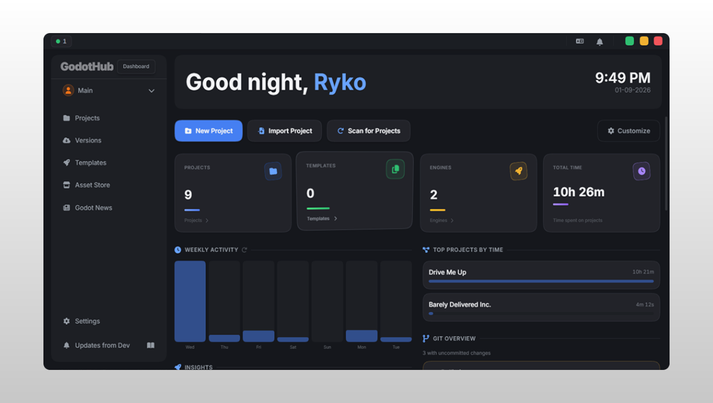
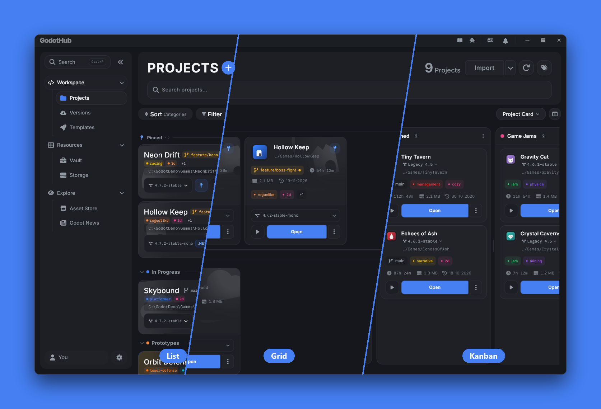
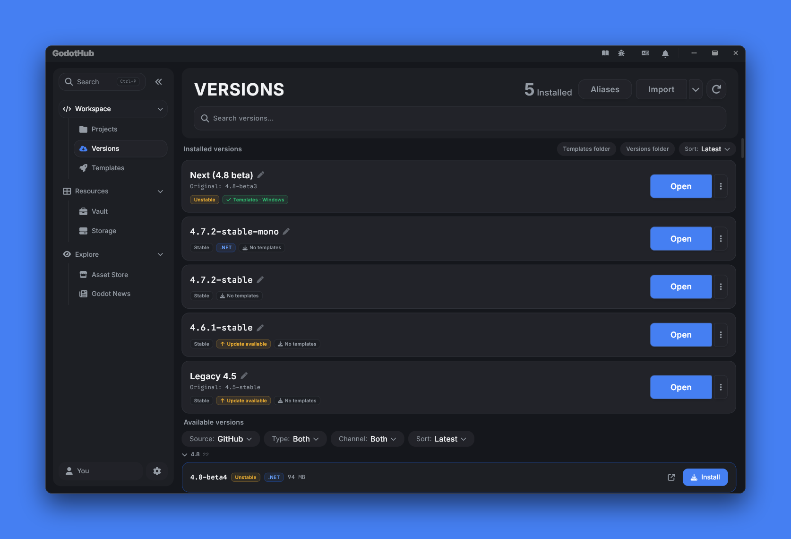
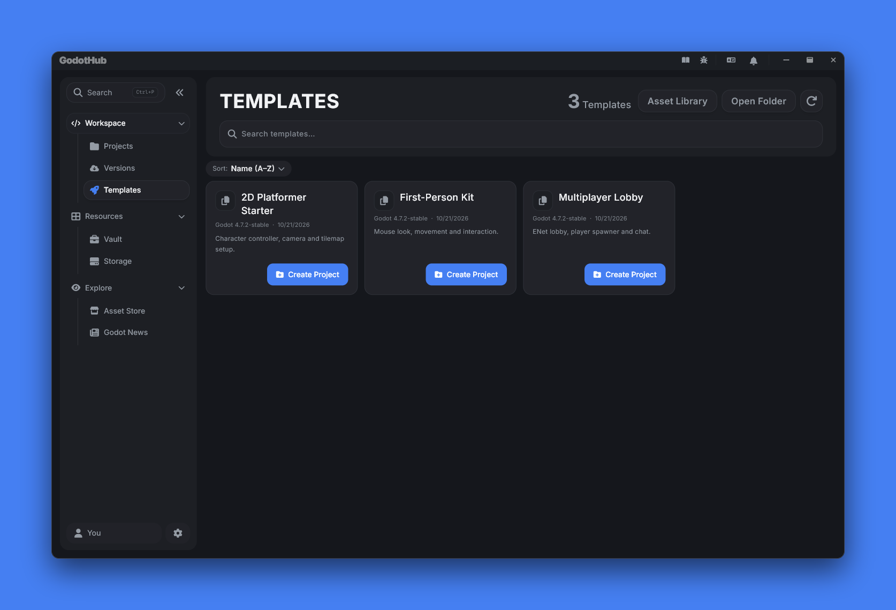
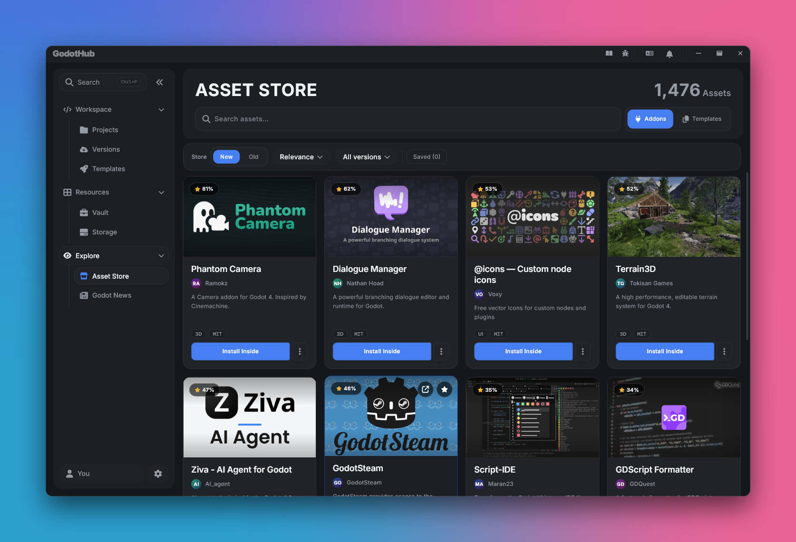
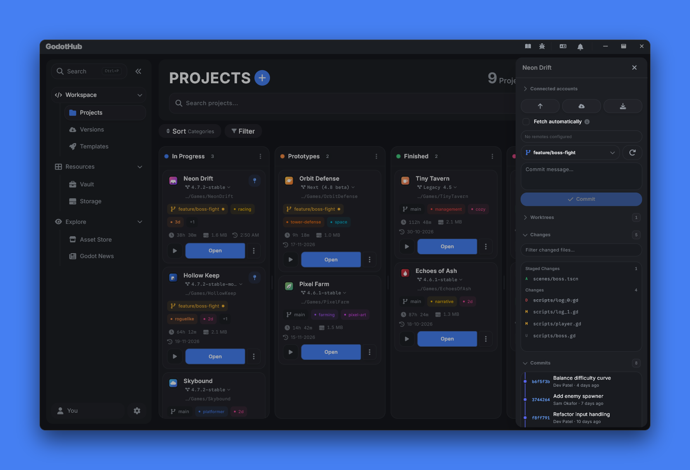
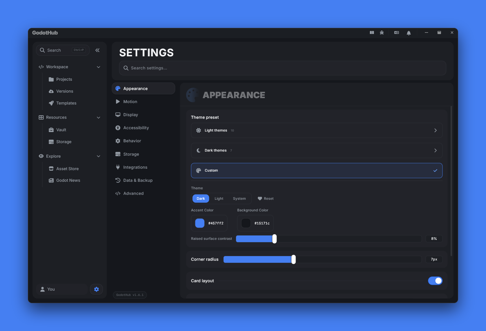
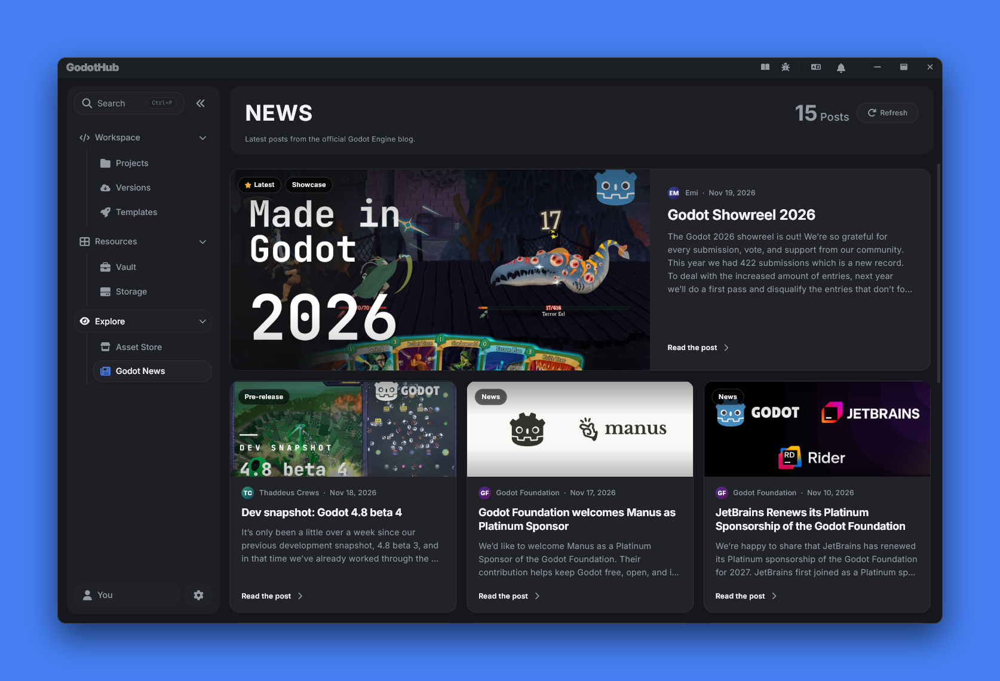

<p align="center">
  <a href="https://ryko.is-a.dev/godothub">
    
  </a>
  <a href="https://patreon.com/TheRyko">
  
  </a>
</p>

## Screenshots

<table>
  <tr>
    <td width="50%" align="center">
      
      <br><strong>Dashboard</strong>
    </td>
    <td width="50%" align="center">
      
      <br><strong>Projects</strong>
    </td>
  </tr>
  <tr>
    <td width="50%" align="center">
      
      <br><strong>Versions</strong>
    </td>
    <td width="50%" align="center">
      
      <br><strong>Templates</strong>
    </td>
  </tr>
  <tr>
    <td width="50%" align="center">
      
      <br><strong>Asset Store</strong>
    </td>
    <td width="50%" align="center">
      
      <br><strong>Git Integration</strong>
    </td>
  </tr>
  <tr>
    <td width="50%" align="center">
      
      <br><strong>Appearance & Settings</strong>
    </td>
    <td width="50%" align="center">
      
      <br><strong>News Feed</strong>
    </td>
  </tr>
</table>

<p align="center"><sub>Screenshots show the dark theme with the default accent color. Everything shown is customizable.</sub></p>

---

<p align="center">
  <a href="https://discord.com/invite/nA7dus32Yv/">
    
  </a>
  &nbsp;
  <a href="https://x.com/theRyko11">
    
  </a>
</p>

---

## Documentation

The full docs live at **[ryko.is-a.dev/godothub-docs](https://ryko.is-a.dev/godothub-docs)**: installation, every feature, the settings reference, keyboard shortcuts, and troubleshooting.

Want to build GodotHub or contribute? See [Build from source](https://ryko.is-a.dev/godothub-docs/contributing/build-from-source) and [Architecture](https://ryko.is-a.dev/godothub-docs/contributing/architecture).

### Flutter migration

GodotHub is a Flutter desktop app (since v1.6.0) built on a shared Rust core. Releases before 1.6.0 were built with Tauri; their installers stay on the releases page, and existing Tauri installs keep reading the same update feeds. The Tauri code itself has been removed from the repository.

---

## Features

### Project Management

<details>
<summary><strong>Details</strong></summary>

| Feature | Description |
|---|---|
| **Create & Import** | Create new projects from scratch or from templates, import existing ones from disk, or clone directly from a Git repo. |
| **List, Grid & Kanban** | Switch between a list, a responsive grid, or a Kanban board with a column per category. Drag projects between columns to recategorize them. |
| **Drag & Drop Reorder** | Rearrange projects with drag-and-drop, within a category or between categories. |
| **Pin Projects** | Pin projects to a dedicated section at the top. |
| **Tags** | Tags are read straight from `project.godot`, so they stay in sync with the Godot launcher. Edit, add, or delete them and the sync follows. |
| **Batch Operations** | Select multiple projects at once to change versions, assign categories, toggle pins, or remove from the library. |
| **Search & Filter** | Search by name or path, filter by category, sort by custom order, name, date, last opened, or size. |
| **Version Warnings** | Flags when a project's bound Godot version is missing or there's a major version mismatch. |
| **Safe With External Drives** | A project on an unplugged drive or an offline network share stays in your library, marked unavailable, and comes back as soon as the drive does. Projects are only removed when you remove them. |
| **Project Properties** | A file breakdown by type (scripts, scenes, images, audio, 3D models, etc.) with sizes and counts. |
| **Custom Launch Args** | Add custom command-line arguments when launching a project. |
| **Quick Actions** | Open the project folder, open in an external editor, or open a terminal at the project path, all from the project card. |
| **Build & Export** | Export a release build from any export preset with the project's bound Godot version. Output streams to the built-in console. |
| **Tests & Lint** | Run GUT or gdUnit4 tests headless, gdlint, or a gdformat check from the Build & Export window, with output in the built-in console. |
| **Project Doctor** | Checks the engine binding, export templates, main scene, import cache, addons, export presets, Git setup and duplicate registrations, with one-click fixes where possible, each shown next to the problem it fixes. |
| **Android Checks** | Projects with an Android export preset get checks for the Android SDK, Java JDK version, keystores and the Gradle build template. Projects that only look mobile (Mobile renderer, ETC2/ASTC textures) get the same checks as notes. |
| **Addons** | Lists every addon in `res://addons` with its version and whether it's enabled, and checks the Godot Asset Library for newer versions. Updating moves the old folder to the Trash and restores it if the update fails. |

</details>

### Godot Version Management

<details>
<summary><strong>Details</strong></summary>

| Feature | Description |
|---|---|
| **Browse Releases** | Pulls the full list of official Godot builds from GitHub, filtered for your platform. |
| **Download & Install** | Progress tracking, resume support, and concurrent downloads (configurable up to 10 at once). |
| **Export Templates** | Install the matching export templates (`.tpz`) for each version, with resumable downloads, SHA-512 verification, and cleanup of unused template folders. |
| **Import Versions** | Import an existing Godot install from any folder, or drag-and-drop a `.zip`. |
| **Grouped Display** | Versions grouped by `major.minor` with collapsible sections. |
| **Filtering** | Filter by build type (Standard / Mono / Both) and channel (Stable / Unstable / Both). |
| **Custom Names** | Give installed versions your own names. |
| **Pin as Current** | Mark one version as the current one. GodotHub drops a `Godot` launcher into its aliases folder, so scripts, test runners, and MCP servers get a stable path that follows the pin. |
| **Version Aliases** | Give extra command names to specific versions; `godot-mono`, `godot-next`, whatever you like. Manage them from the Versions view; delete a launcher from the folder and the alias disappears from the app too. |
| **Auto-Cleanup** | Prunes missing executables from the registry automatically. |

</details>

### Templates

<details>
<summary><strong>Details</strong></summary>

| Feature | Description |
|---|---|
| **Save as Template** | Turn any existing project into a reusable template. |
| **Create from Template** | Start new projects pre-populated with a template's content. |
| **Preview Contents** | Browse a template's full directory tree before using it. |
| **Sync from Directory** | Auto-import templates from a configured scan folder. |
| **File Watcher** | The template directory is watched, so editing a template folder updates the library automatically. |

</details>

### Asset Store & Asset Library

<details>
<summary><strong>Details</strong></summary>

| Feature | Description |
|---|---|
| **Addons & Templates** | One view with two sections: Addons from the Godot Asset Store and the Godot Asset Library, and Templates (demos and starter projects) from the Asset Library. |
| **Search & Filter** | Search by name, filter by category and Godot version, and sort by relevance, last update, name, rating or license. |
| **Install Into Projects** | Install an addon straight into one or several of your projects at once, or download it. |
| **Asset Details** | Open any asset for its screenshots, full description, license, links and Store release notes, and browse every file in the archive before installing. The preview download is reused if you install. |
| **Installed & Updates** | Cards show which of your projects already have an asset you installed through GodotHub and flag a newer version; update each project from the asset's details. |
| **Saved & Not Interested** | Star assets to keep them in a Saved list that works offline, and hide the ones you don't want to see again. Hidden assets can be brought back anytime. |
| **Templates From the Library** | Install demos and templates from the Asset Store's Templates section as local templates, ready for New Project. Hide the ones you already have, save favorites, and hide the ones you're not interested in. |
| **Template Updates** | Templates installed from the Asset Library are flagged when a newer upload exists and can be updated in place. |
| **Showcase Cards** | Cover art (or the asset's own colors behind its icon), glass chips for rating, installs and updates, and quick save, hide and open actions on hover. Cards reflow from one column on a narrow window to six on a wide screen. |

</details>

### Git Integration

<details>
<summary><strong>Details</strong></summary>

| Feature | Description |
|---|---|
| **Status Overview** | Branch name, uncommitted changes, and repo status at a glance. |
| **Stage / Unstage** | Individual files or everything at once. |
| **Commit** | Commit messages with optional amend. |
| **Push / Pull / Fetch** | Sync with remotes. |
| **Branch Management** | List, switch, create, and delete branches. |
| **Stash** | Push, list, apply, and drop stashes. |
| **Diff Viewer** | Inline diff viewer with syntax-colored additions and deletions. |
| **Discard Changes** | Discard all uncommitted changes, with confirmation. |
| **Init & Remote** | Initialize a repo, set or remove remotes. |
| **Undo** | Undo the last commit, or undo a pull. |
| **Auto-Refresh** | Git status polls every 30 seconds. |

</details>

### Workspaces

<details>
<summary><strong>Details</strong></summary>

| Feature | Description |
|---|---|
| **Multiple Workspaces** | Separate workspaces for different projects, clients, or game jams. |
| **Custom Icons & Colors** | Each workspace gets its own icon and color. |
| **Quick Switch** | Switch workspaces from the sidebar dropdown. |

</details>

### Categories

<details>
<summary><strong>Details</strong></summary>

| Feature | Description |
|---|---|
| **Create & Customize** | Custom names and colors from a rich palette. |
| **Collapsible Sections** | Collapse and expand category sections. |
| **Hide & Restore** | Right-click a category to hide it and its projects, then bring it back from the Hidden Categories section. |
| **Drag Between Categories** | Drag projects between categories. |
| **Filter by Category** | Filter the project list by any category. |
| **Enable / Disable** | Turn categories on or off globally from Settings. |

</details>

### News Feed

<details>
<summary><strong>Details</strong></summary>

| Feature | Description |
|---|---|
| **RSS Feed** | Godot-related news and updates. |
| **Cached** | The feed is cached for 15 minutes, and the last copy is shown when you're offline. |
| **Open in Browser** | Click a news item to open the full article. |

</details>

### Appearance & Customization

<details>
<summary><strong>Details</strong></summary>

| Feature | Description |
|---|---|
| **Dark / Light Mode** | Switch between dark and light themes. |
| **Accent Color** | 19 preset accent colors, or any custom hex color. |
| **Background Color** | Presets, or generate one at random. |
| **"Feeling Lucky"** | Randomly generate a whole color scheme in one click. |
| **Corner Radius** | 0 (sharp) to 20px (rounded), applied everywhere. |
| **UI Density** | Scale padding and spacing from 75% (compact) to 125% (spacious). |
| **Font Scale** | Scale all text from 85% to 130%. |
| **Reduce Motion** | Minimize animations for accessibility. |
| **Sidebar Width** | Set expanded and collapsed widths independently. |

</details>

### Settings & Preferences

<details>
<summary><strong>Details</strong></summary>

| Feature | Description |
|---|---|
| **Storage Locations** | Configure scan directories for projects, Godot versions, and templates. Type or paste a path, or browse for it. |
| **Auto-Scan on Startup** | Discover new projects and versions automatically on launch. |
| **File Watchers** | Real-time detection of changes in project, version, and template directories. |
| **Download Concurrency** | How many Godot versions download at once (1-10). |
| **Scan Depth** | How deep to scan folders (1-10 levels). |
| **Close on Launch** | Quit or minimize to tray when launching a project. |
| **Reopen After Godot Closes** | Restore GodotHub automatically when the editor closes. |
| **Tray Menu** | Recent projects in the system tray, the Windows Jump List and the macOS Dock menu (configurable count). |
| **Tooltip Delay** | 100ms to 1000ms. |
| **Command Palette Keybind** | Rebind `Ctrl/Cmd + <key>` to whatever you want. |
| **Export / Import** | Back up or transfer all settings as JSON. |
| **Reset & Wipe** | Reset settings to defaults, or wipe all app data. |

</details>

### Other Bits

<details open>
<summary><strong>Details</strong></summary>

| Feature | Description |
|---|---|
| **Drag & Drop Import** | Drag project folders or `.zip` version archives straight into the app window. |
| **Command Palette** | `Ctrl/Cmd + P` (or your own keybind) for quick navigation. |
| **System Tray** | Minimize to tray with a right-click menu of recently opened projects. |
| **Jump List & Dock Menu** | Right-click GodotHub in the Windows taskbar or the macOS Dock to open a recent project. |
| **Custom Titlebar** | Frameless window, custom title bar. |
| **Splash Screen** | An animated splash screen on startup. |
| **Onboarding Wizard** | Guided first-time setup for workspaces, projects, versions, templates, categories, and appearance. |
| **Auto-Updates** | Checks for updates on startup and installs updates through the app's updater. |
| **Bug Reporting** | Report issues directly from the app. |
| **Changelog Viewer** | See what changed in each release. |
| **Vault** | Save a project as a reusable item in the workspace's vault, with tags, a Godot version and its files. |
| **Command Line** | `godothub open <path>` opens a project (options: `--godot`, `--add`, `--no-add`). Also `run`, `versions`, `install`, `export` and `doctor`. |
| **Discord Rich Presence** | Show the project you are working on in Discord. |
| **Keyboard Shortcuts** | Full shortcut cheatsheet, available anytime. |

</details>

---

## AI Disclosure
<p align="center">

</p>

---

## Installation

### Download Prebuilt Binaries

GodotHub is available as a desktop app for:

| Platform | Download |
|---|---|
| **Windows** | `GodotHub-<version>-windows-x64-setup.exe` (installer), `GodotHub-<version>-windows-x64.msi` (installer), or `GodotHub-<version>-windows-x64-portable.zip` (no install needed; 1.5.x and older used a portable `.exe`) |
| **macOS** | `GodotHub-<version>-darwin-universal.dmg` (Apple Silicon and Intel) |
| **Linux** | `GodotHub-<version>-linux-amd64.deb`, `GodotHub-<version>-linux-x86_64.rpm`, or `GodotHub-<version>-linux-amd64.AppImage` |

Replace `<version>` with the release you're downloading (for example `1.4.4`). Releases before v1.4.4 use the older file names.

### Install via Winget (Windows)

GodotHub is on the **Windows Package Manager (winget)**. On Windows 10/11:

> [!NOTE]
> Winget can lag behind the latest release. Maintainers don't always merge updates right away.

```powershell
winget install Ryko.GodotHub
```

To update:

```powershell
winget upgrade Ryko.GodotHub
```

### Install via Scoop (Windows)

```powershell
scoop bucket add extras
scoop install godothub
```

To update:

```powershell
scoop update godothub
```

### Build from Source

<details>
<summary><strong>Prerequisites</strong></summary>

| Dependency | Version | Purpose |
|---|---|---|
| [Flutter](https://docs.flutter.dev/get-started/install) | Stable (CI uses 3.50.0) | App framework and Dart SDK |
| [Rust](https://rustup.rs) | Stable (CI uses 1.99.1) | Shared core and Flutter bridge |
| Platform desktop toolchain | See below | Native desktop build tools |

</details>

Install the platform-specific Flutter desktop requirements before building:

- **Windows:** Visual Studio with the *Desktop development with C++* workload.
- **macOS:** Xcode and its command-line tools.
- **Linux:** `clang`, `cmake`, `ninja-build`, `pkg-config`, `libgtk-3-dev`,
  `libx11-dev`, `libxi-dev`, and `liblzma-dev`.

```bash
# Clone the repository
git clone https://github.com/RykoTheDev/godothub.git
cd godothub

# Install Flutter dependencies
cd app
flutter pub get

# Run in development mode (replace windows with macos or linux as needed)
flutter run -d windows

# Run checks
flutter analyze
flutter test
(cd .. && cargo test -p godothub_core -p godothub_bridge)

# Build for release
flutter build windows --release
```

> [!WARNING]
> A build from source uses the same data folder as an installed GodotHub, and only one of them can run at a time. Close the installed app first, and back up your data if you are worried about it.

> [!TIP]
> Flutter build outputs are under `app/build/`. The Rust core and Flutter bridge
> live in `crates/` and are built automatically with the app. See
> [CONTRIBUTING.md](CONTRIBUTING.md) for the project layout, the shared UI
> components and how translations work.

---

## Tech Stack

<details>
<summary><strong>View full tech stack</strong></summary>

| Layer | Technology |
|---|---|
| **Desktop UI** | [Flutter](https://flutter.dev) + Dart |
| **State Management** | [Riverpod](https://riverpod.dev) |
| **Core Services** | Rust workspace (`godothub-core`, `godothub-bridge`, `godothub-launcher`) |
| **Flutter/Rust Bridge** | [flutter_rust_bridge](https://cjycode.com/flutter_rust_bridge/) |
| **Localization** | JSON locale files in `app/lib/i18n/json`; [Slang](https://pub.dev/packages/slang) generates typed Dart translations |

</details>

---

## Benchmarks

Before the switch in v1.6.0, the Flutter app was measured against the last Tauri app (1.5.x) on the same machine, display, and data.

<details>
<summary><strong>Windows results</strong></summary>

Windows 11, 180 Hz display, release builds, measured 2026-11-14. "Real" is a copy of an everyday data folder; "bench" is a generated workspace with 120 projects.

| Metric | Tauri | Flutter | Change |
|---|---|---|---|
| Cold start to projects shown, real (median of 5) | 1177 ms | **651 ms** | 45% faster |
| Cold start to projects shown, 120 projects | 1664 ms | **1224 ms** | 26% faster |
| Cold start to interactive, 120 projects | 1887 ms | **1230 ms** | 35% faster |
| Private memory, real (30 s idle) | 192 MB, 7 processes | **168 MB**, 1 process | 13% less |
| Private memory, 120 projects | 248 MB | **136 MB** | 45% less |
| Working set, real / 120 projects | 557 / 683 MB | **228 / 196 MB** | 59% / 71% less |
| Opening Versions for the first time | 356 ms | **30 ms** | |
| Opening Settings for the first time | 340 ms | **20 ms** | |
| Switching views afterwards | 35 to 52 ms | **11 to 21 ms** | |
| Scrolling 120 projects, average fps | 89 to 93 | **181 to 188** | full refresh rate |
| Scrolling, worst frame | 17 to 100 ms | **5.6 to 11 ms** | |
| Drag to reorder, average fps | 168 to 172 | **175 to 180** | |

View times are until the new view first shows; both apps then play the same 0.7 s slide animation.

</details>

### Run them yourself

The benchmark measures the Flutter app on Windows, Linux and macOS:

```bash
cd app
node ../dev/tool/bench/bench.mjs all
```

It needs Node.js 18+ and the Flutter toolchain, and writes `app/build/bench_lab/results/<os>/REPORT.md`. Your data is only copied, never changed. See [dev/tool/bench/README.md](dev/tool/bench/README.md) for the commands, requirements and what each number means.

---

## License

MIT, see [LICENSE](LICENSE) for details.

---

## Acknowledgements

| Project | Why |
|---|---|
| [Godot Engine](https://godotengine.org) | The open-source engine this whole tool is built around. |
| [Flutter](https://flutter.dev) | Cross-platform desktop UI. |
| [Rust](https://www.rust-lang.org/) | Shared core services and command-line launcher. |
| [Flutter Rust Bridge](https://cjycode.com/flutter_rust_bridge/) | Connects the Flutter UI to the Rust core. |
| [Tauri](https://v2.tauri.app) | Framework used by GodotHub before v1.6.0. |
| [React](https://react.dev) | UI library used by GodotHub before v1.6.0. |
| [Tailwind CSS](https://tailwindcss.com) | Styling framework used by GodotHub before v1.6.0. |
| [Font Awesome](https://fontawesome.com) | Icons used throughout the app. |

Plus every other open-source library that makes GodotHub possible, see `app/pubspec.yaml` and the `Cargo.toml` files in `crates/` for the full list.

---

## Star History

<a href="https://www.star-history.com/?repos=RykoTheDev%2FGodotHub&type=timeline&legend=bottom-right">
 <picture>
   <source media="(prefers-color-scheme: dark)" srcset="https://api.star-history.com/chart?repos=RykoTheDev/GodotHub&type=timeline&theme=dark&legend=bottom-right&sealed_token=K0A_747qaDoioaDadvVke_xGw9V06vKC9raC8-6f9w3TolZ6o6E7nqnGAy1Syr-d2Au51bDwvMnagX21RPuTdf2AIKNUoToc8ijpaPEM5LMwTX3RQCznVM4K5g-S11xLT4rrCZYSk2AXLSeK2yyBxOijNAXYmFSJOW5jk0kEDqBFcDWTrIOnAWoGMWbP" />
   <source media="(prefers-color-scheme: light)" srcset="https://api.star-history.com/chart?repos=RykoTheDev/GodotHub&type=timeline&legend=bottom-right&sealed_token=K0A_747qaDoioaDadvVke_xGw9V06vKC9raC8-6f9w3TolZ6o6E7nqnGAy1Syr-d2Au51bDwvMnagX21RPuTdf2AIKNUoToc8ijpaPEM5LMwTX3RQCznVM4K5g-S11xLT4rrCZYSk2AXLSeK2yyBxOijNAXYmFSJOW5jk0kEDqBFcDWTrIOnAWoGMWbP" />
   
 </picture>
</a>
